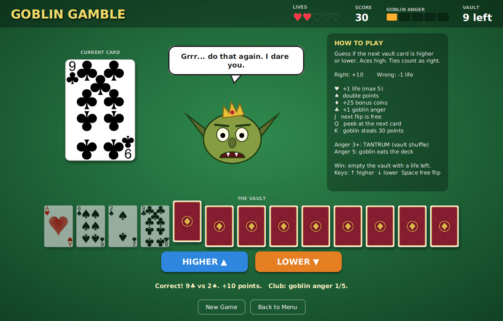
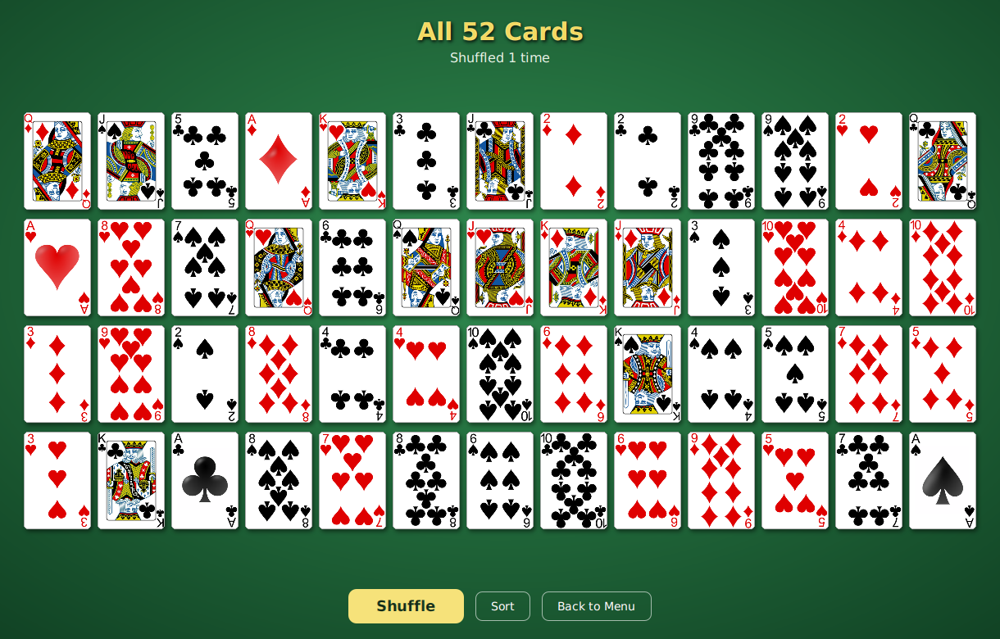

# Lab 5: Card Display + Goblin Gamble

JavaFX app for CS Lab 5 (User Stories).

- **Part 1:** Displays all 52 cards on a green table and shuffles them when you press **Shuffle**.
- **Part 4 (Extra Credit):** **Goblin Gamble**, a higher-or-lower card game against a grumpy vault goblin. Full spec: [`docs/GOBLIN_GAMBLE_SPEC.md`](docs/GOBLIN_GAMBLE_SPEC.md)





Part 1 story beats, estimates, and reflection: [`docs/PART1_STORY_BEATS.md`](docs/PART1_STORY_BEATS.md)

## Run It

Needs **Java 17 or newer**. Maven is optional (the wrapper downloads it).

```bash
./mvnw javafx:run          # macOS / Linux
mvnw.cmd javafx:run        # Windows
```

**IntelliJ:** File → Open → pick `pom.xml` → open as project. Then run `edu.csusm.cards.Main` (or use the Maven panel: Plugins → javafx → `javafx:run`).

Run the tests:

```bash
./mvnw test
```

## How to Play Goblin Gamble

Guess if the next Vault card is **higher** or **lower** than the current card. Empty all 13 Vault cards with at least one life left to win.

| | |
|---|---|
| Correct guess | +10 points (ties count as correct, Aces high) |
| Wrong guess | -1 life |
| ♥ Hearts | +1 life (max 5) |
| ♠ Spades | Double points |
| ♦ Diamonds | +25 bonus coins |
| ♣ Clubs | +1 Goblin Anger |
| Jack | Next flip is free |
| Queen | Peek at the next card |
| King | Goblin steals 30 points |
| Anger 3+ | Tantrum: the goblin shuffles the Vault |
| Anger 5 | The goblin eats the deck. You lose. |

**Keys:** `↑` higher, `↓` lower, `Space` free flip, `N` new game.

## Project Layout

```
src/main/java/edu/csusm/cards/
  Main.java                 entry point
  CardGameApp.java          window + menu
  model/                    Suit, Rank, Card, Deck (shared by both parts)
  display/CardDisplayView   Part 1: 52 cards + Shuffle
  game/GoblinGame           Part 4 rules (no JavaFX, unit tested)
  ui/GoblinGambleView       Part 4 screen and animations
  ui/GoblinView             the goblin, drawn with JavaFX shapes
  ui/Taunts                 things the goblin says
src/main/resources/cards/   card images
src/test/java/...           GoblinGameTest (13 tests)
```

## Credits

- Card faces: **Byron Knoll, "Vector Playing Cards"**, released to the public domain (CC0), via [OpenGameArt.org](https://opengameart.org/content/playing-cards-vector-png). Resized with rounded corners for this project.
- Card back and goblin: made for this project.
